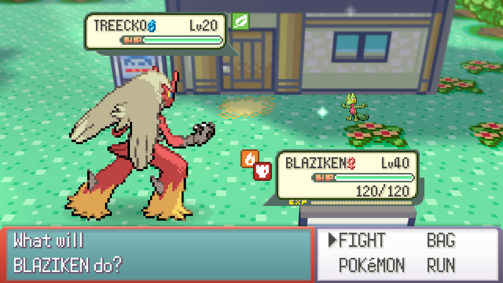
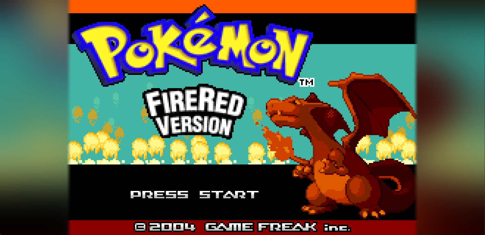

# WoobleView 🖥️

*Sharp Pokémon, battles that fit any screen, and battles set in a 3D world.*

<table>
<tr>
<td width="50%" valign="top" align="center">
 
🏞️ A 3D battle in Littleroot Town, Blaziken towering over a wild Treecko
</td>
<td width="50%" valign="top" align="center">
 
🖥️ FireRed's title screen on a wide screen, the sides softly blurred
</td>
</tr>
</table>

The Pokémon games were drawn for a small, square-ish screen. Played on a phone or a wide monitor
they come out blocky and boxed in. WoobleView makes them look at home on the screen you're
playing on. Pokémon are drawn sharp instead of as blown-up pixels, and battles stretch to fill
your screen without black bars. In the Gen 3 games your battles can even take place right where
you're standing, in a 3D version of the world around you.

It's a display mod for [Gen1Recomp](https://github.com/bryanthaboi/gen1recomp), made for FireRed,
LeafGreen, Ruby, Sapphire and Emerald. Red, Blue, Yellow, Gold, Silver and Crystal get the sharp
Pokémon too ([what works in which game](docs/games.md)).

## ✨ What it does

### 🔍 Sharp Pokémon

With a sprite mod that supports it, Pokémon in battle, in the Pokédex and on the summary screen
are drawn at your screen's full resolution. Pokémon walking around the overworld glide smoothly
instead of stepping pixel by pixel. Menus and text always stay on top, and nothing ever goes
missing: any frame that can't be drawn this way is simply drawn the normal way.

### 🎥 Battles that fit your screen

Every Pokémon appears at the size your sprite mod gives it and is never cut off. If one won't
fit, it's shrunk just enough, or the camera pulls back for a moment. Move effects reach right to
the edges of your screen. Turn on **Fill Screen** and battles, menus, the Pokédex, the summary,
the bag and the intro fill any screen shape. On a phone held upright, the battle fills the space
above the text box and the touch controls.

In every Gen 3 game, the battle's text box and menus become one sharp, modern bar across the
bottom of the screen, in the game's own colours, and the same bar shows after a catch, when a
Pokémon evolves and when an egg hatches.

➡️ [More about fitting battles to your screen](docs/fitting-the-screen.md)

### 🏞️ Battles in a 3D world

Set **Battle Scene** to **Overworld** and battles leave the flat backdrop behind. The camera
swoops down from the overworld, and you fight on open ground near where you stand. Around you
are the towns, gyms, trees and buildings, rebuilt in 3D from the game's own art and lit by the
time of day and the weather.

Pokémon stand at their real sizes, so a Wailord towers over a Pikachu. **3D Sizing** lets you
choose how true to life that is. The camera follows the battle, pulling back for giants and
coming in close for small Pokémon.

➡️ [Everything about 3D battles](docs/battle-scene.md)

## ⚙️ Options

Pick **WOOBLEVIEW** on the game's own OPTION screen, or open **OPTIONS → MODS → WoobleView**.
Everything is on by default except the 3D battles, which you can turn on whenever you like.

| Option | Default | In short |
|---|---|---|
| **Battle HD** | On | Sharp Pokémon in battle. |
| **Battle Fit** | On | Pokémon at your sprite mod's sizes, never cut off. |
| **Fill Screen** | On | Battles and full screens fill your screen. |
| **Battle Textbox** | On | The modern battle text box (Gen 3 games). |
| **Battle Scene** | Classic | Overworld: battles in the 3D world. |
| **3D Sizing** | Medium | How true to life the sizes are in 3D battles. |
| **Build / Clear 3D Cache** | – | Build the 3D world now, or delete it. |
| **Scene Blur** | On | A soft miniature-style blur in 3D battles. |
| **Time of Day** | On | 3D battles lit by the time of day. |
| **Scene Cache** | On | Keep built towns and rooms for fast loading. |
| **Field HD** | On | Sharp Pokémon in the overworld. |
| **Pokedex & Summary HD** | On | Sharp Pokémon in the Pokédex and summary. |

➡️ [Every option and choice explained](docs/options.md)

## 💾 Installation

1. Download the latest release from the
   [Releases](https://github.com/poooooby/gen3-hd-sprites/releases) page.
2. Import it with the Gen1Recomp Mod Manager, or drop it in your mods folder.
3. Enable it, and add a supported sprite mod (below) for sharp Pokémon.

## 🔗 Works With

- [WoobleSpritePack](https://github.com/poooooby/g9-battle-sprites-gen3): sharp battle and
  Pokédex sprites for every Pokémon.
- [Vivid Worlds](https://github.com/poooooby/wilds-of-hoenn) and
  [Vivid Worlds: OG](https://github.com/poooooby/vivid-worlds-og): overworld Pokémon drawn sharp
  and at their true sizes.
- [WoobleDex](https://github.com/poooooby/national_dex_gen3): its move animations play in full,
  filling your whole screen, in 3D battles too. 3D battles also follow its clock and its Day &
  Night setting, and its stat chips stay on screen beside the HP boxes.
- [Galar Rising](https://github.com/poooooby/max-raids): a Dynamaxed Pokémon gets the room it
  needs, its feet where they stood, with the opponent's HP box held steady until it shrinks
  back. In 3D battles it grows as tall as the tallest Pokémon.
- [OmniUI](https://github.com/1Jamie/omni_ui): on every screen OmniUI redraws in its own style,
  battles included, WoobleView steps aside and lets it show that screen its way. Everywhere else,
  WoobleView works as usual.

## 📌 Good to Know

- 👋 The first time you play each Gen 3 game, WoobleView asks whether you'd like 3D battles and
  whether to build that game's 3D world now or while you play. When an update improves the 3D
  world, it asks once whether to rebuild it. You can change all of this in the options.
- 🖼️ Sharp, true-to-size Pokémon need a supported sprite mod. With the game's own sprites, Fill
  Screen still fits battles to your screen.
- 🛟 If something can't be drawn the new way, that moment is drawn the game's usual way and
  WoobleView tries again a couple of seconds later. If it keeps happening, it steps aside until
  you restart the game.

## 🪪 Credits

- **Battle Scene** is adapted from the 3D battles of
  [Emerald 3DS](https://github.com/ZallaxDev/emerald-3ds) by Zallax and contributors: its camera,
  entrance, battle placement, trees, buildings, rooms, land shapes, lighting, day-night cycle and
  weather. The battle text box's modern look follows its HD text box.
- **Kanto's land** in FireRed and LeafGreen comes from
  [Pokémon FireRed 3DS](https://github.com/NachoGonzalez2001/Pokemon-FireRed-3DS) by
  NachoGonzalez2001, and a few of WoobleView's Kanto buildings are modelled after its own.

## 💡 Inspirations

- [Pokémon FireRed 3DS](https://github.com/NachoGonzalez2001/Pokemon-FireRed-3DS) by
  NachoGonzalez2001 first showed Kanto standing in 3D.

---

Licence: [CC BY-NC-SA 4.0](LICENSE) (versions up to 0.6.0: MIT). Making a mod that uses it? See
[DEVELOPMENT.md](DEVELOPMENT.md).
